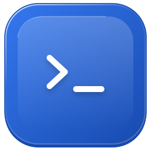

# nano-vim



Terminálový editor, který zná Vim a hledí si svého. Od Jarabacksoft.

**Čeština je hlavní a řídící jazyk projektu.** Anglický překlad je níže;
při rozporu platí česká verze.

## Česky

### Licence

Vlastní kód a projektová dokumentace: **Apache License 2.0**, copyright 2026 Petr Turek.
Viz [LICENSE](LICENSE), [licenční přehled](LICENSING.cs.md) a
[oznámení třetích stran](THIRD_PARTY_NOTICES.txt). Pro distribuci binárky použijte
`python3 scripts/package-release.py /private/tmp/nano-vim-release`.
Autoritativní licenční text je anglický; český přehled je vysvětlení.

### Identita

Modrá příkazová šipka a kurzor vycházejí ze společné identity Jarabacksoft.
SVG a záznam zdroje jsou v `Brand/AppIcon/`; distribuční balíček je přibaluje.
Obnovení z checkoutu webu: `python3 ../jarabacksoft-web/scripts/install-app-icons.py --project .`.
V terminálu se používá ikona terminálové aplikace.

### Instalace

Podporovaný je **macOS a Linux**, případně Linux ve **Windows přes WSL**.
Nativní Windows build zatím není podporovaný. Potřebujete **Go 1.26.1 nebo novější**
a interaktivní terminál. Pokud Go už máte, přeskočte přípravu a přejděte rovnou k instalaci nano-vim.

#### 1. Připravte Go podle svého systému

Verzi ověříte příkazem:

```sh
go version
```

**macOS s Homebrew:**

```sh
brew install go
```

Homebrew zde instaluje Go, nikoli nano-vim. Pokud Homebrew nepoužíváte,
nainstalujte Go přímo přes [oficiální instalátor pro macOS](https://go.dev/doc/install);
není nutné kvůli nano-vim zavádět dalšího správce balíčků.

**Linux — Ubuntu / Debian:**

```sh
sudo apt update
sudo apt install golang-go
```

Potom znovu ověřte `go version`. Verze dostupná přes APT závisí na vydání distribuce.
Pokud je starší než 1.26.1, nebo používáte jinou distribuci, postupujte podle
[oficiálního návodu Go pro Linux](https://go.dev/doc/install) a zvolte balíček pro svou architekturu.
Některé verze Go mohou potřebný novější toolchain stáhnout automaticky; pokud to
vaše prostředí zakazuje, nainstalujte požadovanou verzi Go samostatně.

**Windows — WSL:**

Pokud WSL ještě nemáte, otevřete **PowerShell jako správce** a spusťte:

```powershell
wsl --install
```

Dokončete průvodce, vytvořte uživatele Linuxu a restartujte, pokud o to systém požádá.
Další kroky provádějte v **linuxovém terminálu WSL**, nikoli v PowerShellu.
Pro Ubuntu ve WSL použijte linuxový postup výše.
Podrobnosti: [oficiální návod Microsoftu](https://learn.microsoft.com/en-us/windows/wsl/install).
WSL není nativní Windows aplikace; běží v něm linuxová varianta nano-vim.

#### 2. Nainstalujte nano-vim

Na macOS, Linuxu nebo uvnitř WSL spusťte:

```sh
go install github.com/Jarabacksoft/nano-vim@latest
```

Příkaz stáhne a sestaví nejnovější dostupnou verzi z veřejného repozitáře;
repozitář nemusíte ručně klonovat. Nepotřebuje `sudo`. Závislosti se stahují při
instalaci; hotový editor síť nepotřebuje. Jde o instalaci ze zdrojového kódu přes Go,
nikoli samostatný Homebrew/APT balíček nano-vim nebo stažení hotové binárky.

#### 3. Otevřete soubor

```sh
nano-vim "soubor.txt"
```

Editor očekává právě jeden název souboru. Mezery v názvu uzavřete do uvozovek.
Nový soubor začne prázdný a vytvoří se při uložení. Začínáte v režimu Normal:
`i` přejde na psaní, `Esc` se vrátí do režimu příkazů, `:wq` a Enter uloží a ukončí.
Ukončení bez uložení je `:q!` a Enter.

#### Když terminál nano-vim nenajde

Go ukládá programy do `GOBIN`, pokud je nastavený; jinak obvykle do
`$(go env GOPATH)/bin`. Výchozí adresář přidáte do `PATH` aktuálního terminálu takto:

```sh
export PATH="$PATH:$(go env GOPATH)/bin"
```

Pro trvalé nastavení přidejte tento řádek do konfigurace svého shellu, například
`~/.zshrc` na Macu se zsh nebo `~/.bashrc` s bashem, a otevřete nový terminál.
Pokud používáte vlastní `GOBIN`, přidejte místo výchozí cesty ten; jeho hodnotu
zjistíte přes `go env GOBIN`. Pokud `go` není dostupné vůbec, dokončete nejdříve
oficiální instalaci Go a otevřete nový terminál.

#### Aktualizace a odinstalování

Aktualizace používá stejný příkaz `go install ...@latest` uvedený výše.
Pro odinstalování odeberte pouze binárku `nano-vim` z instalačního adresáře;
není nutné odstraňovat Go, jeho cache ani jiné programy. Nano-vim nemá službu
na pozadí ani vlastní konfigurační adresář. Před odstraněním ověřte skutečnou
cestu přes `command -v nano-vim` a podle nastavení `GOBIN`/`GOPATH`.

### Sestavení a spuštění

Potřebujete Go 1.26.1 nebo novější a unixový terminál (macOS nebo Linux).

```sh
go build -o nano-vim .
./nano-vim 'soubor s mezerami.txt'
```

Pro instalaci zkopírujte binární soubor do adresáře na `PATH`. Předávejte právě
jeden název souboru. Neexistující soubor začne prázdný a vytvoří se při uložení.
Editor začíná v režimu Normal. Jeden proces pracuje s jedním souborem a jedním
bufferem. Nemá konfiguraci, pluginy, projekty, záložky, rozdělená okna, shell ani
služby na pozadí. Závislosti se stahují při sestavení; hotový editor síť nepotřebuje.

### Klávesy a příkazy

Příkazy začínající `:` potvrďte klávesou Enter. Názvy příkazů jsou stejné v obou
jazykových verzích dokumentace.

| Činnost | Klávesy |
| --- | --- |
| Pohyb | `h j k l`, šipky, `w b e`, `0 ^ $`, `gg G` |
| Skok na řádek | `:42`, `42G` nebo `42gg` |
| Zobrazení/skrytí čísel řádků | `:number` |
| Absolutní/relativní čísla | `:relative` |
| Posun o půl obrazovky | Ctrl-D, Ctrl-U |
| Vkládání | `i a I A o O`; Esc vrací do režimu Normal |
| Úpravy při vkládání | Text, Enter, Tab, Backspace, Delete, šipky |
| Výběr | `v` po znacích, `V` po řádcích; pohyb rozšiřuje výběr |
| Práce s výběrem | `d` smazat, `y` zkopírovat, `c` změnit; Esc zrušit |
| Mazání/náhrada | `x`, `r` a znak, `dd`, `dw`, `de`, `d$`, `d0`, `D` |
| Změna textu | `cw`, `cc`, `C` |
| Kopírování/vložení | `yy`, `p` za/pod, `P` před/nad |
| Spojení řádků | `J` |
| Historie | `u`, Ctrl-R; jedno vkládání je jeden krok zpět |
| Opakování změny | `.` včetně vloženého textu |
| Hledání | `/text` dopředu, `?text` dozadu; Enter potvrdit, Esc zrušit |
| Opakování hledání | `n` stejným směrem, `N` opačně; `*`/`#` slovo pod kurzorem |
| Uložení/ukončení | `:w`, `:q`, `:wq`, `:q!` |
| Znovunačtení aktuálního souboru | `:e`; odmítne neuložené změny |

Počty fungují pro pohyby, mazání, kopírování, vložení, náhradu, spojování řádků,
historii, opakování hledání a změn: `3dd`, `2dw`, `4w`, `2p`, `3x`. Počty
operátoru a pohybu se násobí (`2d3w`). Počty vkládání a textových objektů chybí.

Za `d`, `c` nebo `y` lze použít textové objekty `iw`, `aw`, `i"`, `a"`, `i'`,
`a'`, `i(`, `a(`, `i[`, `a[`, `i{`, `a{`. Příklady: `ciw`, `yiw`, `ci"`, `da(`.
Závorky mohou být vnořené a přes více řádků. Uvozovky se párují na aktuálním
řádku; escapované uvozovky se přeskakují. Nerozpoznaný objekt buffer nezmění.
Nejde o parser programovacího jazyka.

### Čísla řádků a přeskakování

Po spuštění se zobrazují absolutní čísla. `:number` čísla skryje nebo zobrazí.
`:relative` přepíná mezi absolutními čísly a vzdáleností od aktuálního řádku;
aktuální řádek vždy ukazuje své absolutní číslo. Relativní `5` nad/pod kurzorem
odpovídá pohybu `5k`/`5j`. Zvolený režim se zachová i při skrytí čísel.
Oba přepínače platí pouze v aktuálním procesu, bez konfiguračního souboru.

`:42`, `42G` a `42gg` přesunou kurzor na začátek řádku 42. Samotné `G` skočí
na poslední řádek, `gg` na první. Číslo za koncem souboru skočí na poslední
řádek; `:0` a čísla mimo rozsah typu integer se odmítnou. Počítané skoky fungují
i při výběru. Čísla se neposouvají vodorovně a v příliš úzkém okně se skryjí.

### Hledání, schránka a stav

Hledání je doslovné, rozlišuje velikost písmen, přechází přes konec/začátek a
prohledává pouze aktuální buffer. Prázdný dotaz opakuje předchozí vzor zvoleným
směrem. Hledání slova používá doslovný vzor.

Interní nepojmenovaný registr funguje vždy. Kopírování do systémové schránky
používá OSC 52 přes tcell, pokud to terminál dovolí. Ze systémové schránky
vkládejte běžnou funkcí terminálu. Bracketed paste vkládá znaky jako text a podle
potřeby vstoupí do režimu Insert.

Stavový řádek ukazuje režim, soubor, pozici kurzoru, přibližný průchod souborem a
`[+]` u neuložených změn. V úzkém okně vynechává méně důležité údaje. Poslední
řádek obsahuje zprávy a vstup hledání či příkazu. Vlastní názvy režimů a
hlášky editoru jsou dvojjazyčné, česky první. Původní chyby systému nebo knihovny
mohou být v jazyce daného prostředí.

### Soubory a terminál

UTF-8 a jednotné LF/CRLF se zachovávají bez přidání závěrečného odřádkování.
Podporované jsou prázdné soubory, tabulátory a názvy s mezerami. Neplatné UTF-8,
binární řídicí znaky, samostatné CR, smíšené LF/CRLF, jiné než běžné soubory a
soubory nad 32 MiB se odmítají. Tento limit platí i při ukládání.

Nové soubory mají práva 0600; existující práva se zachovávají. Existující symlinky
se při otevření vyhodnotí; neplatné symlinky se odmítají. Uložení hardlinků je
odmítnuté. Uložení zapíše a synchronizuje dočasný soubor ve stejném adresáři a
přejmenuje jej na cíl. Chyba zachová rozpracovaný obsah v paměti.

`:q` a `:e` chrání neuložené změny. Uložení kontroluje změnu obsahu, vytvoření,
smazání a změnu konců řádků na disku. Konflikt odmítne; `:q!` výslovně zahodí
úpravy. Změnu mezi poslední kontrolou a přejmenováním nelze zcela vyloučit.
Nahrazení zachovává běžná práva, ale ne všechna rozšířená metadata či ACL.

Editor vyžaduje interaktivní vstupní i výstupní terminál. Změna velikosti překreslí
obrazovku. Normální ukončení, chyby po inicializaci a SIGINT/SIGTERM/SIGHUP obnoví
nastavení terminálu i původní obrazovku. Signály ukončí editor bez uložení;
průběžně používejte `:w`. Ctrl-C funguje jako Esc. SIGKILL ani výpadek stroje
nemohou provést úklid.

### Testování

```sh
go test ./...
go test -race ./...
go vet ./...
go test -fuzz=FuzzKeys -fuzztime=15s
go build -o nano-vim .
python3 tests/terminal_test.py
python3 tests/package_release_test.py
```

Python test používá standardní knihovnu a skutečné PTY. Ověřuje úpravy, uložení
CRLF, hledání, chráněné ukončení, šipky, výběr, změnu velikosti, vložení textu,
čísla řádků, skoky, signály a obnovu terminálu. Go testy pokrývají příkazy,
textové objekty, historii, Unicode, integritu souborů, neplatné vstupy a vykreslení.
Test balení ověřuje odmítnutí chybějících licenčních textů a umístění licence Go v Homebrew.

### Známá omezení

Jde o vybranou podmnožinu Vimu. Pozice a úpravy používají jednotlivé Unicode
code pointy; složená emoji a kombinované znaky nejsou nedělitelné jednotky.
Šířky znaků podle knihovny se mohou lišit od konkrétního terminálu. Výběr zahrnuje
oba konce. Schránka závisí na povolení OSC 52; editor schránku nečte ani nespouští
externí pomocníky. Historie ukládá celé kopie bufferu, takže u velkých souborů
spotřebovává paměť. Počítané textové objekty, počty vkládání, automatické odsazení,
zvýraznění syntaxe a regulární výrazy nejsou implementované.

PTY testy byly provedeny na macOS. Linuxové sestavení je ověřené, ale interaktivní
Linux a schránka či zobrazení ve fyzickém terminálu stále vyžadují ruční ověření.

## English

A terminal editor that knows Vim, but minds its own business. By Jarabacksoft.
**Czech is the primary and authoritative project language.** This section is a
translation; the Czech version takes precedence if the two differ.

### Licensing

Own code and project documentation: **Apache License 2.0**, copyright 2026 Petr Turek.
See [LICENSE](LICENSE), the [licensing overview](LICENSING.en.md), and
[third-party notices](THIRD_PARTY_NOTICES.txt). For binary redistribution use
`python3 scripts/package-release.py /private/tmp/nano-vim-release`.
The English license text is authoritative; the Czech overview is explanatory.

### Identity

The blue prompt arrow and cursor use the shared Jarabacksoft identity.
`Brand/AppIcon/` contains the SVG variants and source receipt, included in release bundles.
Refresh from the website checkout with `python3 ../jarabacksoft-web/scripts/install-app-icons.py --project .`.
Terminal sessions use the terminal application's own icon.

### Installation

Supported environments are **macOS and Linux**, including Linux on **Windows through WSL**.
A native Windows build is not supported yet. You need **Go 1.26.1 or newer**
and an interactive terminal. If Go is already installed, skip setup and install nano-vim directly.

#### 1. Set up Go for your operating system

Check your version:

```sh
go version
```

**macOS with Homebrew:**

```sh
brew install go
```

Homebrew installs Go here, not nano-vim. If you do not use Homebrew,
use the [official Go installer for macOS](https://go.dev/doc/install);
there is no need to add another package manager just for nano-vim.

**Linux — Ubuntu / Debian:**

```sh
sudo apt update
sudo apt install golang-go
```

Check `go version` again. APT's Go version depends on the distribution release.
If it is older than 1.26.1, or you use another distribution, follow the
[official Go instructions for Linux](https://go.dev/doc/install) and choose your architecture.
Some Go versions can download a newer required toolchain automatically; if your
environment disables that, install the required Go version separately.

**Windows — WSL:**

If WSL is not installed, open **PowerShell as administrator** and run:

```powershell
wsl --install
```

Finish setup, create your Linux user account and restart if requested.
Continue in your **WSL Linux terminal**, not PowerShell. For Ubuntu in WSL,
follow the Linux steps above. Details: [Microsoft's official guide](https://learn.microsoft.com/en-us/windows/wsl/install).
WSL runs the Linux version of nano-vim; this is not a native Windows app.

#### 2. Install nano-vim

On macOS, Linux or inside WSL, run:

```sh
go install github.com/Jarabacksoft/nano-vim@latest
```

This downloads and builds the latest available version from the public repository;
no manual clone is needed. It does not require `sudo`. Dependencies are downloaded
during installation; the installed editor works offline. This is a Go source
installation, not a dedicated Homebrew/APT package or prebuilt binary download.

#### 3. Open a file

```sh
nano-vim "file.txt"
```

Supply exactly one filename; quote filenames containing spaces. A missing file
starts empty and is created on save. Startup uses Normal mode: `i` starts typing,
`Esc` returns to command mode, and `:wq` followed by Enter saves and quits.
To quit without saving, use `:q!` followed by Enter.

#### If your terminal cannot find nano-vim

Go installs executables into `GOBIN` when configured, otherwise normally into
`$(go env GOPATH)/bin`. Add the default directory to the current terminal's `PATH`:

```sh
export PATH="$PATH:$(go env GOPATH)/bin"
```

To make this permanent, add the line to your shell configuration, such as `~/.zshrc`
for zsh on macOS or `~/.bashrc` for bash, and open a new terminal. If you use a custom
`GOBIN`, add that directory instead; inspect it with `go env GOBIN`. If `go` itself
is unavailable, finish the official Go installation first and open a new terminal.

#### Updating and uninstalling

Update with the same `go install ...@latest` command shown above. To uninstall,
remove only the `nano-vim` executable from its install directory; you do not need
to remove Go, its cache or other tools. Nano-vim has no background service or own
configuration directory. Before removing anything, inspect the actual location
with `command -v nano-vim` and your `GOBIN`/`GOPATH` settings.

### Build and run

Requires Go 1.26.1 or newer and a Unix terminal (macOS or Linux).

```sh
go build -o nano-vim .
./nano-vim 'file with spaces.txt'
```

To install, copy the binary to a directory on `PATH`. Supply exactly one filename.
A missing file starts empty and is created on save. Startup uses Normal mode.
One process edits one file and one buffer. There are no configuration files,
plugins, projects, tabs, splits, shells, or background services. Dependencies are
downloaded at build time; the binary needs no network at runtime.

### Keys and commands

Confirm commands beginning with `:` using Enter. Command names are identical in
both documentation languages.

| Action | Keys |
| --- | --- |
| Move | `h j k l`, arrows, `w b e`, `0 ^ $`, `gg G` |
| Jump to line | `:42`, `42G`, or `42gg` |
| Show/hide line numbers | `:number` |
| Absolute/relative numbers | `:relative` |
| Half-screen movement | Ctrl-D, Ctrl-U |
| Insert | `i a I A o O`; Esc returns to Normal |
| Insert editing | Text, Enter, Tab, Backspace, Delete, arrows |
| Selection | `v` character-wise, `V` line-wise; motions extend it |
| Use selection | `d` delete, `y` copy, `c` change; Esc cancels |
| Delete/replace | `x`, `r` then a character, `dd`, `dw`, `de`, `d$`, `d0`, `D` |
| Change | `cw`, `cc`, `C` |
| Copy/paste | `yy`, `p` after/below, `P` before/above |
| Join lines | `J` |
| History | `u`, Ctrl-R; an Insert session is one undo step |
| Repeat change | `.` including inserted text |
| Search | `/text` forward, `?text` backward; Enter confirms, Esc cancels |
| Repeat search | `n` same direction, `N` opposite; `*`/`#` use the word under the cursor |
| Save/exit | `:w`, `:q`, `:wq`, `:q!` |
| Reload current file | `:e`; refuses unsaved changes |

Counts work on motions, deletion, copying, pasting, replacement, joining, history,
search repetition, and repeated changes: `3dd`, `2dw`, `4w`, `2p`, `3x`.
Operator and motion counts multiply (`2d3w`). Insert counts and counted text objects
are absent.

After `d`, `c`, or `y`, use `iw`, `aw`, `i"`, `a"`, `i'`, `a'`, `i(`, `a(`,
`i[`, `a[`, `i{`, `a{`. Examples: `ciw`, `yiw`, `ci"`, `da(`. Brackets may nest
and span lines. Quotes pair within the current line, skipping escaped delimiters.
Unresolved objects leave the buffer intact. This is not a programming-language parser.

### Line numbers and jumping

Absolute numbers appear at startup. `:number` shows or hides the gutter.
`:relative` switches between absolute numbers and distances from the current line;
the current line always shows its absolute number. Relative `5` above/below the
cursor corresponds to `5k`/`5j`. The mode survives hiding the gutter. Both toggles
apply only to the current process, with no configuration file.

`:42`, `42G`, and `42gg` jump to the beginning of line 42. Plain `G` goes to the
last line and `gg` to the first. Out-of-file requests clamp to the last line;
`:0` and integer overflow are rejected. Counted jumps extend Visual selections.
The gutter stays fixed horizontally and disappears in excessively narrow windows.

### Search, clipboard, and status

Search is literal, case-sensitive, wraps around, and examines only this buffer.
An empty query repeats the previous pattern in the entered direction. Word search
uses a literal pattern.

The internal unnamed register always works. Terminal clipboard copying uses OSC 52
through tcell where permitted. Paste from the system clipboard using your terminal.
Bracketed paste inserts characters as text and enters Insert mode when needed.

The status line shows mode, filename, cursor position, approximate progress, and
`[+]` for unsaved changes. Narrow windows omit lower-priority fields. The final
line holds messages and search/command input. Mode labels and editor messages
are bilingual, Czech first. Underlying system or library errors may use the
language of the environment.

### Files and terminal

UTF-8 and uniform LF/CRLF round-trip without adding a final newline. Empty files,
tabs, and filenames with spaces are supported. Invalid UTF-8, binary control
characters, bare CR, mixed LF/CRLF, nonregular files, and files over 32 MiB are
rejected. The limit also applies when saving.

New files use mode 0600; existing permissions are preserved. Existing symlinks are
resolved at open; dangling symlinks are rejected. Hard-linked saves are refused.
Saving writes and syncs a temporary file in the same directory, then renames it over
the target. Failure preserves in-memory work.

`:q` and `:e` protect unsaved edits. Saves check external content changes, creation,
deletion, and line-ending changes. Conflicts are refused; `:q!` explicitly discards
edits. Changes between the final disk check and rename cannot be fully excluded.
Replacement preserves ordinary permissions, but not all extended metadata or ACLs.

Interactive input and output terminals are required. Resizing redraws the screen.
Normal exits, errors after initialization, and SIGINT/SIGTERM/SIGHUP restore terminal
settings and the original screen. Signals exit without saving; use `:w` regularly.
Ctrl-C behaves as Esc. SIGKILL and machine failure cannot run cleanup.

### Testing

```sh
go test ./...
go test -race ./...
go vet ./...
go test -fuzz=FuzzKeys -fuzztime=15s
go build -o nano-vim .
python3 tests/terminal_test.py
python3 tests/package_release_test.py
```

The Python test uses the standard library and real PTYs to check editing, CRLF saving,
search, protected quit, arrows, selection, resizing, pasted text, line numbers,
jumps, signals, and restoration. Go tests cover commands, text objects, history,
Unicode, file integrity, invalid input, and rendering.
Packaging tests check rejection of missing license texts and the Homebrew Go license location.

### Known limits

This is a selected Vim subset. Cursor positions and edits use Unicode code points;
complex emoji and combining sequences are not indivisible units. Library width rules
can differ from individual terminals. Selections include both endpoints. Clipboard
support depends on OSC 52 policy; there is no clipboard reader or external helper.
History stores full buffer snapshots, consuming memory on large files. Counted text
objects, insert counts, autoindent, syntax highlighting, and regex search are absent.

PTY tests have run on macOS. Linux builds are verified; interactive Linux and physical
terminal clipboard/display behavior still need manual checks.
